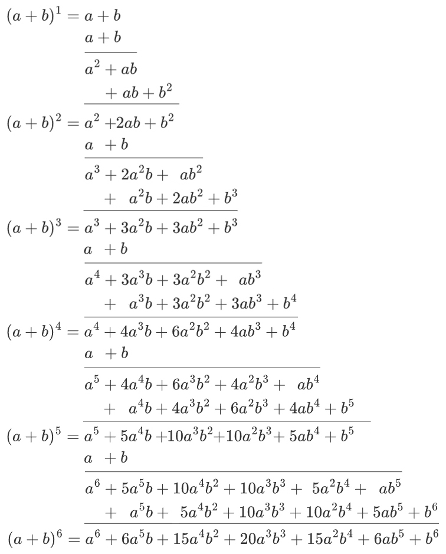

# 整数次幂的二项式定理

## 实验材料

- 1个长度和宽度分别为118.9cm和84.1cm的A0白板
- 黑色，红色，和蓝色的白板笔
- 白板擦

## 实验步骤

1. 依据乘法分配律， $(a+b)^2 = (a+b)(a+b)$ 的运算结果是： $a·a+2·a·b+b·b$，简化表达为： $aa+2ab+bb$。

2.  $(a+b)^3 = (a+b)(a+b)(a+b)$ 的运算结果是： $a·a·a+3·a·a·b+3·a·b·b+b·b·b$，简化表达为： $aaa+3aab+3abb+bbb$。

3.  $(a+b)^4 = (a+b)(a+b)(a+b)(a+b)$ 的运算结果是： $aaaa+4aaab+6aabb+4abbb+bbbb$。

4.  $(a+b)^5 = (a+b)(a+b)(a+b)(a+b)(a+b)$ 的运算结果是： $aaaaa+5aaaab+10aaabb+10aabbb+5abbbb+bbbbb$。

5.  $(a+b)^6 = (a+b)(a+b)(a+b)(a+b)(a+b)(a+b)$ 的运算结果是： $aaaaaa+6aaaaab+15aaaabb+20aaabbb+15aabbbb+6abbbbb+bbbbbb$。

7. 对各项中a和b的幂次进行分析，可以观察到不包括系数的各项出现的规律：
- $(a+b)^1 = a+b$，从左到右每一项中a出现的次数分别是1，0，b出现的次数分别是0，1。
- $(a+b)^2 = aa+2ab+bb$，从左到右每一项中a出现的次数分别是2，1，0，b出现的次数分别是0，1，2。
- $(a+b)^3 = aaa+3aab+3abb+bbb$，每一项中a出现的次数分别是3，2，1，0，b出现的次数分别是0，1，2，3。
- $(a+b)^4 = aaaa+4aaab+6aabb+4abbb+bbbb$，a出现的次数分别是4，3，2，1，0，b出现的次数分别是0，1，2，3，4。
- $(a+b)^5 = aaaaa+5aaaab+10aaabb+10aabbb+5abbbb+bbbbb$，a出现的次数分别是5，4，3，2，1，0，b出现的次数分别是0，1，2，3，4，5。
- $(a+b)^6 = aaaaaa+6aaaaab+15aaaabb+20aaabbb+15aabbbb+6abbbbb+bbbbbb$，a出现的次数分别是6，5，4，3，2，1，0，b出现的次数分别是0，1，2，3，4，5，6。
- 可以观察到各项出现的规律：首先，第一项中 a 的幂次等于 a+b 自乘的次数，b 的幂次为 0。在随后的各项中，a 的幂次依次减少 1，b 的幂次则依次增加 1。每一项中 a 和 b 的幂次之和始终不变，都等于 a+b 自乘的次数。
- 可以推断出 a + b 的10次幂，即10个 a + b 自乘，不包括系数的各项将按照下面的顺序相继出现: $a^{10}，a^9b^1，a^8b^2，a^7b^3，a^6b^4，a^5b^5，a^4b^6，a^3b^7，a^2b^8，ab^9，b^{10}$。
- 推断出对于 $(a+b)^n$ 的展开式，从左到右每一项中a出现的次数分别是n, n-1, n-2, ...，2，1，0，b出现的次数分别是0，1，2，...，n-2，n-1，n。一共有 n+1 项。

8. 令a=5, b=7, 计算出 $(a+b)^5$ 的数值，同时计算出相应展开式的数值之和，感受等式两边的数值是相等的。

9. 令 $a=\sqrt{3}, b=2\sqrt{3}$，计算出 $(a+b)^7$ 的数值，同时计算出相应展开式的数值之和，感受等式两边的数值是相等的。

## 参考文献及资料

1. 维基百科
	- [Binomial coefficient](https://en.wikipedia.org/wiki/Binomial_coefficient) | [二项式系数](https://zh.wikipedia.org/wiki/%E4%BA%8C%E9%A0%85%E5%BC%8F%E4%BF%82%E6%95%B8) 
	- [Binomial theorem](https://en.wikipedia.org/wiki/Binomial_theorem) | [二项式定理](https://zh.wikipedia.org/wiki/%E4%BA%8C%E9%A1%B9%E5%BC%8F%E5%AE%9A%E7%90%86) 